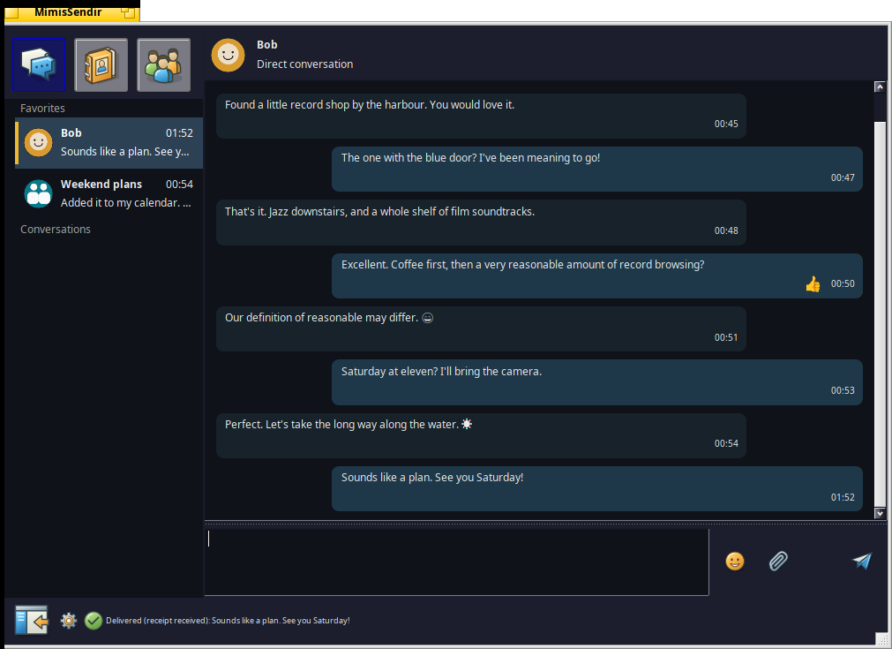
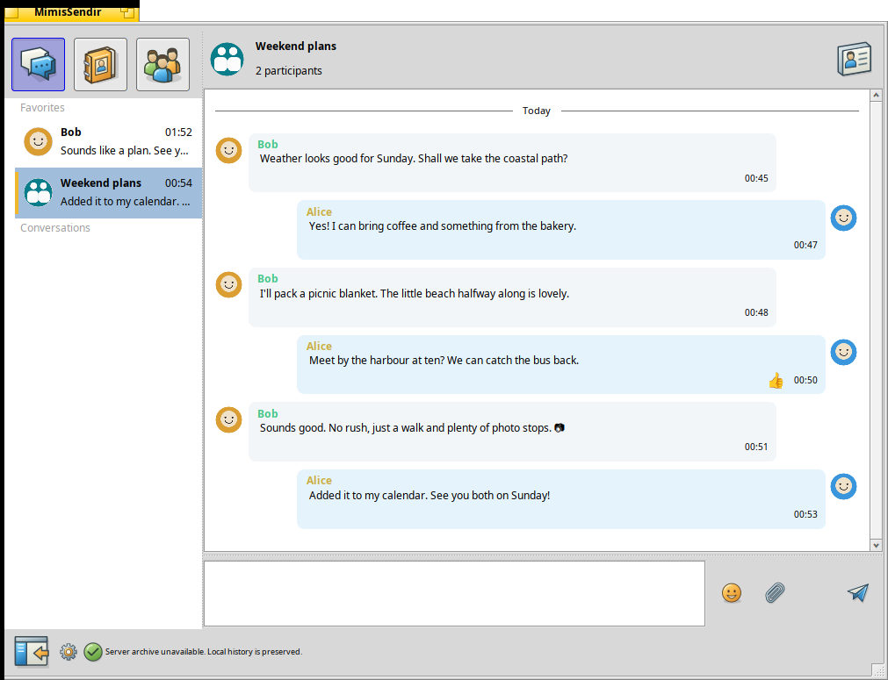

# MímisSendir

Native messaging for **Haiku x86_64**, developed by **Kambuzi EDB**, based on [Renga](https://pulkomandy.tk/projects/renga).

[Download beta releases](https://github.com/kambuziarendal/MimisSendir/releases) · [Install and configure](docs/public/CLIENT.md) · [Build](COMPILING.md) · [Report a bug](https://github.com/kambuziarendal/MimisSendir/issues)

Real Haiku screenshots with fictional accounts, messages and artwork. No private conversations are shown.

## Why we built it

We wanted to use Haiku as our daily driver. Being able to keep using Signal was the last obstacle, so we built MímisSendir to close that gap. This started as a tool for our own everyday desktop, and we are sharing it for others who want to make the same move.

## Features

- Conversations, contacts and groups in a native Haiku interface.
- Persistent local history, attachments and previews.
- Emoji, local GIFs and imported Signal sticker packs.
- Message editing and reactions next to the timestamp.
- A jump-to-latest button when you scroll up, and cached contact/group pictures.
- Optional Signal conversations through a separately operated Slidgnal bridge.

## Signal sticker packs: use WebPositive (Web+)

Open [Signal Stickers](https://signalstickers.org/) in **WebPositive (Web+)**, then click the pack's install button. **Do not use Firefox for that button on Haiku**: its custom-protocol handoff does not open the pack installer reliably. Review the pack in MímisSendir before importing it. This is a browser handoff limitation, not a problem with the sticker pack.

## Early beta

Beta 6 adds read receipts: outgoing messages show **Read** when a matching XEP-0333 displayed marker arrives. Group receipts show the number of reporting participants, never an assumed “everyone”. Incoming markable messages are acknowledged only after visible foreground dwell. Read status survives restart; delivery receipts and reactions are not treated as reads. Signal behavior depends on the bridge and the peer’s privacy settings. Native synthetic XMPP verification is separate from a live Signal test.

The newest client is **beta 6**. Earlier betas are retained for comparison and recovery, not recommended over beta 6. Public builds have neutral server defaults and contain no API key or preconfigured account. Configure your own XMPP server in Settings. Online GIPHY search is unavailable without a separately configured provider key; local GIFs work offline.

Tested on Haiku R1/beta6 hrev59866+79, x86_64. No hosted messaging account is included. Signal needs an existing phone account and a separate bridge; **Signal encryption terminates at that bridge**, not at this Haiku application. This is not an official Signal client. See [security and privacy](docs/public/SECURITY-PRIVACY.md).

The package replaces Renga and preserves its profile/application identity for upgrades. Do not install both side by side. Back up your profile before upgrading. Long histories can still make the UI slow; interoperability beyond the tested server setup is not guaranteed.

## Plans

- Make the self-hosted bridge easier to install, with a guided setup and a clean-install test.
- Explore a **Matrix bridge via mautrix** as a backup to the current Signal/XMPP route. This is planned work, not an implemented fallback or an automatic failover feature.

## Development and credits

Developed with AI-assisted programming using **OpenAI Codex through OpenClaw**. Kambuzi EDB is responsible for the changes and releases. No endorsement by OpenAI, OpenClaw, Signal or the upstream projects is implied.

The original Renga authors and [MIT license](LICENSE) are retained. Linked dependencies have separate terms, including gloox's GPL; the distributed executable is **not MIT-only**. See [licenses](docs/public/LICENSES.md) and [third-party notices](THIRD-PARTY-NOTICES.md). Source tags and source archives accompany the binaries.

[Documentation](docs/public/README.md) · [Bridge source patches](bridge/README.txt) · [Spritz Depot](docs/public/SPRITZ-DEPOT.md)
